# 多重環境變因下的 3D 高斯濺射場景重建效能評估

### Performance Evaluation of 3D Gaussian Splatting Scene Reconstruction under Multiple Environmental Variables

> 本報告整合兩學期 V1-V11 的完整研究流程、資料採集策略、COLMAP / Structure-from-Motion、3D Gaussian Splatting 訓練、量化評估、失敗案例與最終最佳方法。

---

## 摘要

近年來，3D Gaussian Splatting（3DGS）因具備高品質新視角合成、快速最佳化與即時渲染能力，逐漸成為影像式三維場景重建的重要方法。然而，3DGS 的最終品質高度依賴輸入影像、相機視角分布，以及前端 Structure-from-Motion（SfM）所估計的相機姿態與初始稀疏點雲，因此在實際室內場景中，拍攝位置、影像重疊率、光照、反射、視野範圍、影像數量與相機移動軌跡等因素皆可能直接影響最終 Gaussian scene 與 rendered video。

本研究以室內會議室作為主要實驗場景，研究歷經兩個階段。

第一階段 V1-V7 主要建立完整的影像採集、COLMAP、Nerfstudio / Splatfacto 訓練與新視角渲染流程，並探索人工光源、自然光、反光、過曝、低紋理、固定站位、影像密度及前端影像篩選等問題。其中 V6 以影像品質篩選及 Highlight Mask 改善 COLMAP 輸入，取得 PSNR 25.359 dB、SSIM 0.8845 與 LPIPS 0.2351。

第二階段 V8-V11 則將研究焦點由「拍攝後如何修正影像」轉向「如何從資料取得階段建立更好的多視角資料」。參考 Tanks and Temples 等大型影像式三維重建資料集的影片式資料取得形式後，本研究改採 iPhone 4K 60 fps 連續錄影，再利用 FFmpeg 以 1 fps 等時間間隔抽取 JPG 影像，並比較 1× 與 0.5× 鏡頭，以及三圈高／中／低分層環繞與單圈連續垂直掃描等不同 camera trajectories。

V10 取得全體實驗最高 PSNR 31.228 dB、SSIM 0.9529 與最低 LPIPS 0.09185；V11 則取得 PSNR 29.265 dB、SSIM 0.9522、LPIPS 0.09596。雖然 V10 在量化指標上略高，但 V11 在實際 PLY 場景完整性、近距離物件穩定性及 rendered room-tour 影片中呈現最佳整體品質，因此被本研究選定為最終 Overall Best Version。

本研究最終顯示，室內 3DGS 場景重建不能單純以影像張數判定資料品質。相機位置分布、相鄰影像 overlap、視野範圍、近距離物件的重複觀察以及連續且多高度的 camera trajectory，皆比單純增加影像數量更具影響力。

**關鍵詞：** 3D Gaussian Splatting、COLMAP、Structure-from-Motion、Camera Trajectory、Image Acquisition、Indoor Scene Reconstruction、Novel View Synthesis

---

# 目錄

- [第一章 緒論](#第一章-緒論)
- [第二章 技術背景](#第二章-技術背景)
- [第三章 系統架構與實驗環境](#第三章-系統架構與實驗環境)
- [第四章 第一階段：V1-V7 探索與流程建立](#第四章-第一階段v1-v7-探索與流程建立)
- [第五章 第二階段：V8-V11 拍攝策略最佳化](#第五章-第二階段v8-v11-拍攝策略最佳化)
- [第六章 定量評估與圖表比較](#第六章-定量評估與圖表比較)
- [第七章 綜合結果分析](#第七章-綜合結果分析)
- [第八章 最終最佳版本 V11](#第八章-最終最佳版本-v11)
- [第九章 研究限制](#第九章-研究限制)
- [第十章 結論與未來工作](#第十章-結論與未來工作)
- [附錄](#附錄)
- [參考文獻](#參考文獻)

---

# 第一章 緒論

## 1.1 研究背景

影像式三維場景重建的主要目標，是利用不同相機位置所取得的二維影像，推估場景的三維結構及視覺外觀。

傳統 Structure-from-Motion（SfM）可透過多視角影像中的共同特徵建立 camera poses 及 sparse point cloud，而 Multi-View Stereo（MVS）則可進一步建立較密集的幾何資訊。

近年來 Neural Radiance Fields（NeRF）與 3D Gaussian Splatting（3DGS）進一步將研究焦點由單純的幾何重建延伸至高品質的新視角合成。

3DGS 使用大量具有：

- 三維位置
- Scale
- Rotation
- Opacity
- View-dependent appearance
- Spherical Harmonics coefficients

的 Gaussian primitives 描述場景，並透過可微分 rasterization 進行最佳化。

然而，3DGS 並不代表前端資料品質變得不重要。

若輸入影像存在：

- Motion blur
- Overexposure
- Strong reflection
- Low-texture surfaces
- Poor overlap
- Insufficient viewpoint diversity
- Incorrect camera poses

COLMAP 所得到的 SfM 結果可能產生缺失或錯誤，進一步影響後續 Gaussian scene 初始化與訓練品質。

---

## 1.2 研究動機

本研究最初以固定位置多角度拍攝會議室。

實際場景中包含：

- 大面積白色低紋理牆面
- 天花板人工燈
- 自然光
- 高亮區域
- 桌椅遮蔽
- 電視螢幕反射
- 近距離物件
- 固定攝影位置附近的 blind spot

因此第一學期最初主要從「影像品質」與「光影干擾」角度出發。

但隨著 V1-V7 的實驗逐步進行，本研究發現：

> 即使增加照片數量，如果相機位置與視角分布不理想，3DGS 品質仍可能下降。

例如 V4.2 的影像數量高於 V4.1，但三個主要評估指標反而更差。

另一方面，V7 大幅減少至 70 張影像後，又產生明顯重建失敗。

因此真正重要的問題逐漸由：

> 「應該使用多少張影像？」

轉變為：

> 「應該如何取得有效的多視角資訊？」

---

## 1.3 研究方向演進

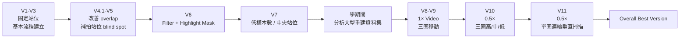

整體研究可概括為：

### 第一階段

**改善已取得的資料**

→ 光照控制  
→ Filter  
→ Mask  
→ 補拍

### 第二階段

**改善資料本身的取得方式**

→ Video  
→ Continuous movement  
→ Wide FOV  
→ Camera trajectory design

---

## 1.4 研究目的

本研究主要目的如下：

1. 建立完整的室內 3DGS reconstruction pipeline。
2. 探討光照、反射、過曝、低紋理與影像模糊的影響。
3. 評估固定位置與移動式拍攝策略。
4. 分析影像數量與有效多視角資訊量的關係。
5. 比較 1× 與 0.5× Field of View。
6. 比較不同 camera trajectories。
7. 建立 PSNR、SSIM、LPIPS、Geometry Completeness 與 Rendered Video 的綜合評估方式。
8. 找出本研究場景下的最佳資料採集策略。

---

# 第二章 技術背景

## 2.1 3D Gaussian Splatting

3D Gaussian Splatting 使用顯式的 Gaussian primitives 描述三維場景。

相較於需要大量 ray sampling 的 NeRF，3DGS 可以直接將 Gaussian 投影至影像平面並進行 rasterization，因此具有良好的即時渲染能力。

本研究使用 Nerfstudio 中的 **Splatfacto** 進行訓練。

---

## 2.2 COLMAP 與 Structure-from-Motion

COLMAP 在本研究中負責：

1. Feature Extraction
2. Feature Matching
3. Camera Intrinsic / Extrinsic Estimation
4. Incremental Reconstruction
5. Sparse Point Cloud Generation

整體關係如下：

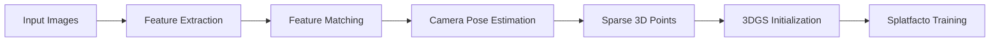

本研究保存的 Splatfacto config 顯示：

> `camera_optimizer.mode = off`

因此 COLMAP 所估計的相機姿態不會再由 Splatfacto camera optimizer 進行額外最佳化。

這使得前端影像與 COLMAP 品質對最終結果更加重要。

---

## 2.3 評估指標

本研究使用三項主要 image-space metrics：

| 指標 | 主要意義 | 理論上較佳方向 |
|---|---|---|
| **PSNR** | Pixel-level reconstruction error | **↑ 越高越好** |
| **SSIM** | 結構、亮度、對比相似性 | **↑ 越高、越接近 1 越好** |
| **LPIPS** | Learned perceptual feature distance | **↓ 越低越好** |
| **Standard deviation** | 不同 evaluation views 之離散程度 | 一般 **↓ 較穩定**，但不能獨立代表品質 |

### PSNR

PSNR 主要衡量像素值誤差。

較高：

> 代表 rendered image 與 reference image 在 pixel level 上較接近。

---

### SSIM

SSIM 同時考慮：

- Luminance
- Contrast
- Structure

SSIM 越接近：

> **1.0**

通常代表結構一致性越高。

---

### LPIPS

LPIPS 使用 learned deep features 衡量 perceptual distance。

因此與 PSNR / SSIM 相反：

> **LPIPS 越低越好。**

---

## 2.4 本研究對「最佳版本」的定義

本研究不以單一 image metric 決定最佳版本。

最終評估方式為：

```text
Quantitative Metrics
        +
Geometry Completeness
        +
Rendered Video Quality
        =
Overall Reconstruction Quality
```

原因在於 PSNR / SSIM / LPIPS 主要衡量 evaluation image，而無法完整反映：

- 三維場景缺洞
- Floating artifacts
- Disconnected Gaussian noise
- 近距離物件破碎
- Camera movement 時的畫面穩定性

---

# 第三章 系統架構與實驗環境

## 3.1 第一階段 Pipeline

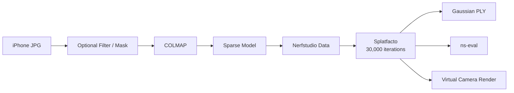

---

## 3.2 第二階段 Pipeline

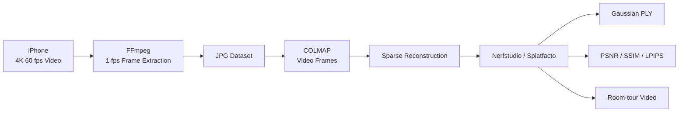

---

## 3.3 拍攝裝置

本研究使用：

- iPhone 14 Plus
- iPhone 16

同一個 Version 內只使用一台固定裝置。

由於早期裝置與版本的完整對應紀錄未全部保存，因此本研究不嘗試事後推測。

---

## 3.4 第二階段影片規格

V8-V11：

- Resolution：4K
- Frame rate：60 fps

實際進入 COLMAP 的並不是全部 60 fps frames。

影片先在 macOS 使用 FFmpeg：

```bash
ffmpeg -i "filename.mp4" -vf fps=1 -q:v 2 "frame_%04d.jpg"
```

因此：

> 每秒實際取得約 1 張 JPG 作為 reconstruction dataset。

---

## 3.5 COLMAP

第二階段統一使用：

- Data Type：Video Frames
- Quality：High
- Shared Intrinsics：Enabled
- Sparse Model：Enabled
- Dense Model：Disabled

第一階段部分 COLMAP 設定可能曾進行調整，因此跨學期比較時，COLMAP preset 亦須視為可能的流程差異之一。

---

## 3.6 Splatfacto 訓練設定

已保存的正式 config 中主要參數如下：

| Parameter | Setting |
|---|---|
| Method | `splatfacto` |
| Device type | CUDA |
| Seed | 42 |
| Maximum iterations | 30,000 |
| Camera optimizer | Off |
| SH degree | 3 |
| SSIM lambda | 0.2 |
| Random initialization | False |
| Load 3D points | True |
| Evaluation mode | Fraction |
| Training fraction | 0.9 |
| Refinement interval | 100 |
| Stop split iteration | 15,000 |
| Save interval | 2,000 |

其中：

> `train_split_fraction = 0.9`

代表約 90% images 用於 training、10% 用於 evaluation。

---

# 第四章 第一階段：V1-V7 探索與流程建立

> V4.1 與 V4.2 為 V4 的兩個子版本，因此若以實驗資料列計算，總共有 12 組版本標籤，但研究命名仍為 V1-V11。

---

## 4.1 版本條件總覽

| Version | Images | Light | Natural Light | Main Position | Main Modification |
|---|---:|---|---|---|---|
| V1 | 241 | On | Yes | TV 前固定 | 第一次完整拍攝 |
| V2 | 389 | On | Yes | TV 前固定 | 提高影像密度 |
| V3 | 288 | Off | Yes | TV 前固定 | 減少人工燈高光 |
| V4.1 | 303 | On | Yes | 會議室中段牆前 | 新 observation center + 反向補拍 |
| V4.2 | 366 | Off | Yes | TV 前固定 | 更密集拍攝 |
| V5 | 263 | On | Yes | TV 前固定 | 補拍站位周圍 |
| V6 | 303 → 276 | On | Yes | 基於 V4.1 | Filter + Highlight Mask |
| V7 | 70 | On | Yes | 房間中央 | 大幅減少樣本 |

> 第一階段所稱「開窗」代表打開窗簾／百葉使自然光進入，而不是研究窗戶機械開關本身。

---

## 4.2 V1：首次固定站位拍攝

V1 共：

> **241 images**

主要特性：

- iPhone
- 1×
- 開燈
- 自然光進入
- 電視螢幕前固定位置
- 拍攝方向較隨機
- 焦距固定

此版本主要目的不是追求最佳結果，而是驗證：

> Image → COLMAP → 3DGS

完整流程是否可行。

V1 未保存正式 evaluation metrics。

---

## 4.3 V2：提高影像密度

V2：

> **389 images**

環境與 V1 大致相同。

主要改變：

- 相鄰照片 movement 減少
- Angle step 減少
- Image overlap 增加
- TV 顯示較亮、較不反光畫面

此階段開始發現：

> 圖片之間必須保有足夠共同視野，才能協助 feature matching。

V2 同樣未保存正式 evaluation metrics。

---

## 4.4 V3：關閉人工燈

V3：

> **288 images**

環境：

- 人工燈關閉
- 自然光保留

目的：

> 減少天花板人工燈所造成的 overexposure、blur 與 reflection。

量化結果：

| Metric | Value |
|---|---:|
| PSNR | 22.906 |
| SSIM | 0.8249 |
| LPIPS | 0.2714 |

實驗結果顯示：

> 關閉人工燈並非純粹正向改善。

雖然高光可能下降，但部分暗部區域與低紋理區域的可辨識資訊亦可能降低。

---

## 4.5 V4.1：改變拍攝位置並補足 Blind Spot

V4.1：

> **303 images**

主要站位由 TV 前移至：

> **會議室中段牆前**

主要改進：

- 相鄰照片 rotation 更小
- Body translation 更小
- Overlap 增加
- 完成主要拍攝後離開原 observation center
- 回頭拍攝原站立位置附近物件

此策略用於解決：

> 固定位置下，攝影者腳下／身旁區域無法從其他角度被觀察。

結果：

| Metric | Value |
|---|---:|
| PSNR | 24.946 |
| SSIM | 0.8719 |
| LPIPS | **0.1793** |

V4.1 為第一階段：

> **LPIPS 最佳版本。**

---

## 4.6 V4.2：更多 Images 不代表更好

V4.2：

> **366 images**

比 V4.1：

> 多約 21%

但結果：

| Metric | V4.1 | V4.2 |
|---|---:|---:|
| PSNR ↑ | **24.946** | 21.576 |
| SSIM ↑ | **0.8719** | 0.8277 |
| LPIPS ↓ | **0.1793** | 0.2950 |

這是本研究非常重要的發現之一：

> **Image Count ≠ Reconstruction Quality**

影像數量不是唯一因素。

更重要的可能包含：

- Camera position
- Feature visibility
- Overlap
- Lighting
- Viewpoint distribution

但 V4.1 與 V4.2 同時包含多項變因，因此不能將差距單獨歸因於某一項因素。

---

## 4.7 V5：補拍原站位附近區域

V5：

> **263 images**

主要維持 TV 前固定拍攝。

完成主要拍攝後：

> 向外移動，再反向拍攝原站位周圍的物件。

結果：

| Metric | Value |
|---|---:|
| PSNR | 23.390 |
| SSIM | 0.8790 |
| LPIPS | 0.2865 |

---

## 4.8 V6：影像 Filter + Highlight Mask

V6 直接以：

> **V4.1 原始 303 images**

為基礎。

處理後：

- Passed：276
- Discarded：27

### V6 流程

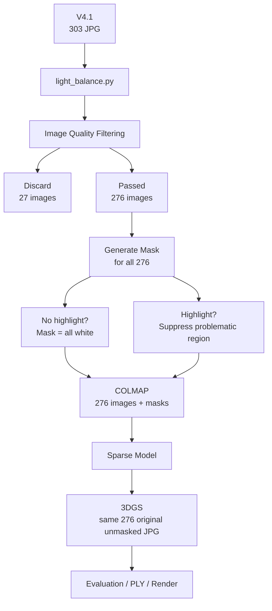

舊報告記錄的主要影像判斷包含：

### Blur

Laplacian Variance：

```text
blur_score < 15
```

### Low Texture

Canny Edge Density：

```text
edge_density < 0.004
```

### Highlight

以高亮 pixel threshold 約：

```text
> 245
```

建立 overexposure region，並透過 morphology 擴張需忽略區域。

---

### V6 的重要資料流程

COLMAP 使用：

> **276 passed images + masks**

3DGS 使用：

> **相同 276 張 passed images 的原始、未遮罩 JPG**

而不是重新使用 303 張。

因此不存在 303 vs 276 camera pose mismatch。

---

### V6 結果

| Metric | V4.1 | V6 | Change |
|---|---:|---:|---:|
| PSNR ↑ | 24.946 | **25.359** | +0.413 |
| SSIM ↑ | 0.8719 | **0.8845** | +0.0126 |
| LPIPS ↓ | **0.1793** | 0.2351 | Worse |

因此：

> Filter + Mask 提升了 PSNR / SSIM，但沒有同步改善 LPIPS。

而且 V6 同時包含：

- Filtering
- Mask
- Dataset reduction

所以不能把改善全部歸因於 Mask。

---

## 4.9 V7：70 張影像的低樣本實驗

V7：

> **70 images**

拍攝位置改為：

> 房間中央

研究目的：

- 平衡攝影者與各方向距離
- 減少 dataset size

結果：

| Metric | Value |
|---|---:|
| PSNR | 13.726 |
| SSIM | 0.7105 |
| LPIPS | 0.5776 |

此版本出現非常明顯的 reconstruction failure。

可支持的結論是：

> 在本會議室、本拍攝方式與當時 pipeline 下，70 張影像不足以提供穩定的 SfM / 3DGS reconstruction。

但不能宣稱：

> 「70 張以下普遍無法建立 3DGS。」

因為 V7 同時改變：

- Image count
- Camera location

因此並非單一變因實驗。

---

# 第五章 第二階段：V8-V11 拍攝策略最佳化

## 5.1 學期間的研究轉折

學期間，本研究重新檢視大型影像式三維重建 datasets。

其中 Tanks and Temples 所提供的 raw data 使用連續影片形式，並可透過固定時間間隔取樣建立 image dataset。

研究團隊將相關資料送入既有 pipeline 後，發現其 reconstruction quality 明顯優於早期固定位置 dataset。

因此研究重點由：

> **Repair bad data after capture**

轉為：

> **Acquire better data from the beginning**

---

## 5.2 第二階段共同條件

V8-V11 固定環境：

- 室內燈開啟
- 窗戶關閉
- 電視播放複雜但盡量不產生強烈反射的畫面
- 不使用 V6 Filter
- 不使用 V6 Mask
- 4K 60 fps video
- FFmpeg 1 fps frame extraction
- COLMAP Data Type = Video Frames

---

## 5.3 V8：1× 三圈影片式環繞

裝置：

> **iPhone 14 Plus**

Images：

> **390**

拍攝方式：

- 背部盡量靠牆
- 鏡頭主要朝向房間內部
- 環繞三圈
- 第一圈：High
- 第二圈：Middle
- 第三圈：Low

---

### V8 結果

| Metric | Value |
|---|---:|
| PSNR | 26.612 |
| SSIM | 0.9128 |
| LPIPS | 0.1752 |

相較固定站位：

> 整個房間的 macro structure 變得更完整。

但出現新的問題：

- 靠近攝影者的桌椅
- 近牆物體
- 只被少量 frames 看到的區域

容易形成：

- Blurry Gaussian
- Disconnected noise
- Floating artifacts

---

## 5.4 V9：不同裝置與不同拍攝者

裝置：

> **iPhone 16**

Images：

> **328**

拍攝者與 V8 不同，但盡可能維持相同拍攝策略。

結果：

| Metric | Value |
|---|---:|
| PSNR | 21.983 |
| SSIM | 0.8514 |
| LPIPS | 0.2756 |

V8 / V9 在視覺 failure mode 上相似，但量化結果差異不小。

因此不能單純宣稱：

> iPhone 14 Plus 與 iPhone 16 沒有差異。

因為同時存在：

- Device
- Photographer
- Frame count
- Real camera movement

等差異。

較合理的結論是：

> 兩版本共同暴露了 1× 移動式拍攝對近距離 coverage 的限制。

---

## 5.5 V10：0.5× Wide FOV

V10：

- iPhone 14 Plus
- 0.5×
- 445 images
- 三圈高／中／低
- 步行速度略慢，但差異不大

V10 的主要變化為：

> **1× → 0.5×**

並讓手機：

> 盡量靠近攝影者身體

以增加每一 frame 可包含的空間範圍。

---

### V10 結果

| Metric | Value |
|---|---:|
| PSNR | **31.228** |
| SSIM | **0.9529** |
| LPIPS | **0.09185** |

V10 是：

> **全體版本中量化指標最強的版本。**

---

## 5.6 V11：單圈連續垂直掃描

V11：

- iPhone 16
- 0.5×
- 477 images

與 V10 不同：

> 不再拍 High / Middle / Low 三個獨立環繞。

拍攝者只沿牆：

> **繞房間一圈**

但手機持續：

> High → Low → High → Low

一圈約完成：

> **16 個 vertical waves**

---

## 5.7 V10 與 V11 Camera Trajectory

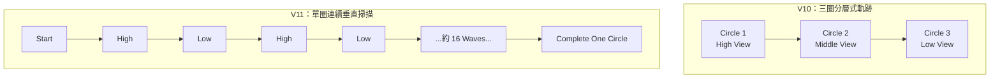

V11 應描述為：

> **近似正弦波式連續垂直掃描軌跡**

而不是精確 mathematical sine wave，因為實際操作為人工手持掃描。

---

## 5.8 V11 結果

| Metric | Value |
|---|---:|
| PSNR | 29.265 |
| SSIM | 0.9522 |
| LPIPS | 0.09596 |

與 V10：

| Metric | V10 | V11 |
|---|---:|---:|
| PSNR ↑ | **31.228** | 29.265 |
| SSIM ↑ | **0.95293** | 0.95215 |
| LPIPS ↓ | **0.09185** | 0.09596 |

SSIM 差約：

> **0.00078**

LPIPS 差約：

> **0.0041**

因此兩個版本 image-space quality 非常接近。

但實際觀察中：

> V11 的 geometry completeness、近距離物件穩定度與 rendered room-tour 為所有版本最佳。

所以 V11 被選為：

> **Overall Best Version**

---

# 第六章 定量評估與圖表比較

## 6.1 完整 Evaluation Result

V1 / V2 沒有保存正式 evaluation，因此下列量化分析由 V3 開始。

| Version | Images | PSNR ↑ | PSNR Std | SSIM ↑ | SSIM Std | LPIPS ↓ | LPIPS Std |
|---|---:|---:|---:|---:|---:|---:|---:|
| V3 | 288 | 22.9063 | 4.9253 | 0.8249 | 0.1099 | 0.2714 | 0.1805 |
| V4.1 | 303 | 24.9462 | 3.0330 | 0.8719 | 0.0559 | 0.1793 | 0.0673 |
| V4.2 | 366 | 21.5765 | 4.9531 | 0.8277 | 0.0887 | 0.2950 | 0.1858 |
| V5 | 263 | 23.3901 | 3.1935 | 0.8790 | 0.0869 | 0.2865 | 0.1219 |
| V6 | 276 | 25.3589 | 3.1608 | 0.8845 | 0.0515 | 0.2351 | 0.0663 |
| V7 | 70 | 13.7259 | 2.6608 | 0.7105 | 0.0380 | 0.5776 | 0.1622 |
| V8 | 390 | 26.6117 | 7.2695 | 0.9128 | 0.1038 | 0.1752 | 0.1839 |
| V9 | 328 | 21.9828 | 5.3393 | 0.8514 | 0.1336 | 0.2756 | 0.1715 |
| V10 | 445 | **31.2281** | 3.6253 | **0.9529** | 0.0405 | **0.09185** | 0.0901 |
| V11 | 477 | 29.2645 | 2.8683 | 0.9522 | **0.0274** | 0.09596 | **0.0607** |

---

## 6.2 PSNR

> **Higher is Better ↑**

PSNR 主要代表 pixel-level reconstruction fidelity。

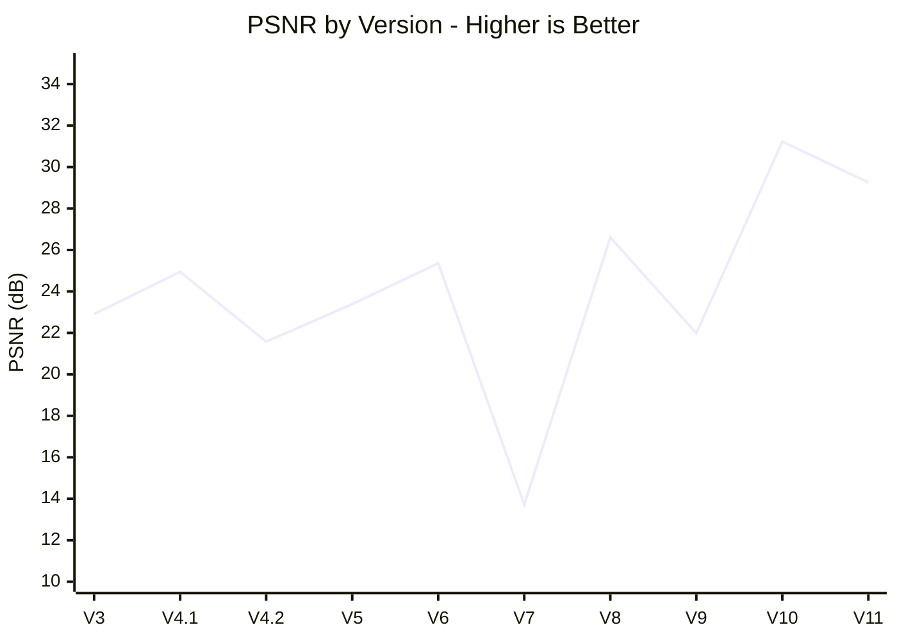

### 觀察

- 第一階段最高：V6
- 第二階段最高：V10
- V11：第二高
- V7：明顯最低

---

## 6.3 SSIM

> **Higher is Better ↑**

SSIM 越接近：

> **1**

通常代表影像結構越接近 reference。

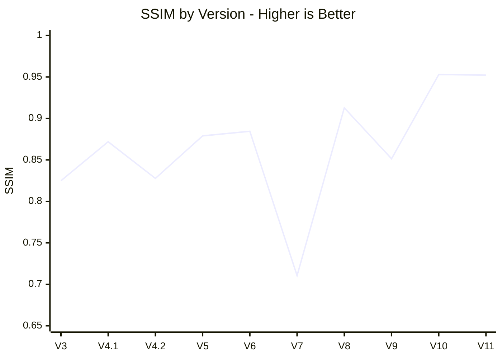

V10 與 V11：

> 幾乎相同。

---

## 6.4 LPIPS

> **Lower is Better ↓**

LPIPS 與 PSNR / SSIM 方向相反。

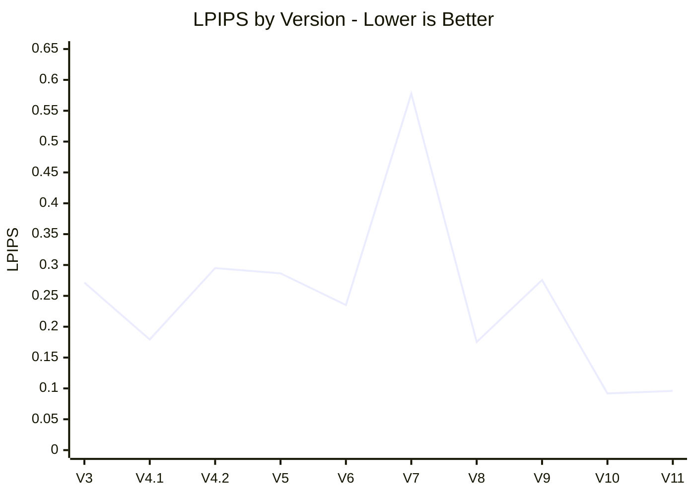

最好的兩個版本：

1. V10
2. V11

---

## 6.5 Image Count

> **Image Count 本身沒有「越高越好」的理論方向。**

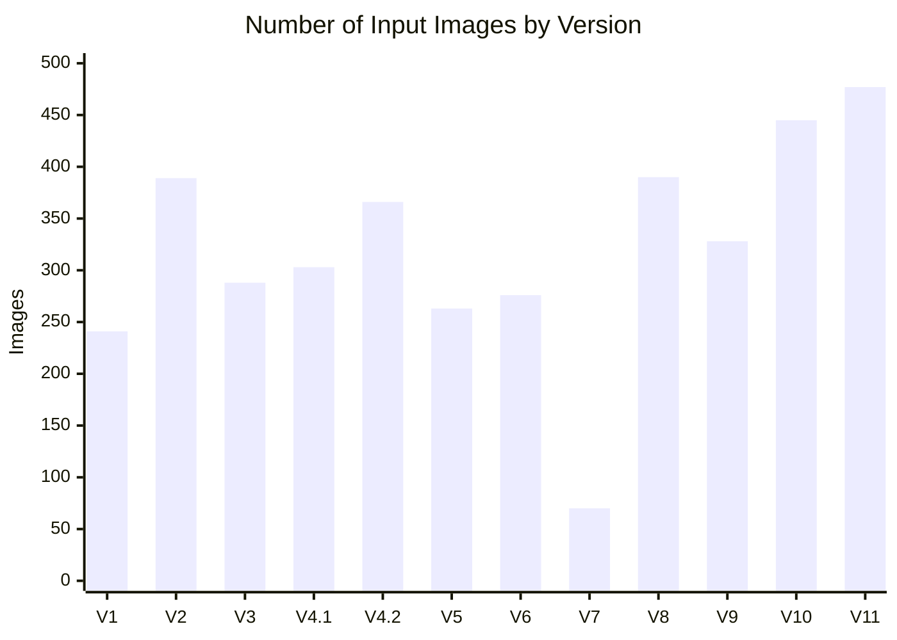

### 重要觀察

V4.2：

> 366 images

比 V4.1：

> 303 images

更多。

但 V4.2 的三項 image metrics 全部較差。

因此不能將：

> **更多 images**

直接等同於：

> **更好的 reconstruction**

---

## 6.6 Standard Deviation

Standard deviation 可協助理解：

> 不同 evaluation views 之間的一致性。

一般而言：

> **較低 = 不同視角間表現較穩定**

但：

> 不應單獨作為 reconstruction quality 指標。

例如一個模型如果所有 views 都很差，也可能具有很低的 standard deviation。

V11 的：

- PSNR std：2.868
- SSIM std：0.0274
- LPIPS std：0.0607

皆相對穩定。

---

# 第七章 綜合結果分析

## 7.1 Image Count 並非主要決定因素

實驗中可清楚看到兩種極端：

### 樣本不足

V7：

> 70 images

結果明顯失敗。

代表：

> dataset 必須至少提供足夠的 scene coverage。

---

### 樣本較多但品質較差

V4.2：

> 366 images

仍低於 V4.1：

> 303 images

因此在達到基本 coverage 後，更重要的因素可能是：

- Viewpoint distribution
- Image overlap
- Feature visibility
- Lighting consistency
- Camera translation
- FOV

---

## 7.2 Fixed Position 的限制

固定站位主要提供：

> Orientation change

但 camera center translation 非常有限。

因此可能造成：

- Baseline 不足
- 攝影者附近區域無法從其他位置看到
- Nearby objects observation count 偏少
- Blind spot

V4.1 / V5 的反向補拍能部分解決此問題，但仍不是完整的 continuous trajectory。

---

## 7.3 Continuous Video 的優勢

V8 之後最大的改變並不是：

> 「影片比較方便。」

而是：

> Camera position 開始真正沿空間連續移動。

因此同一物件可以由：

> 多個不同 camera centers

觀察。

這增加了：

- Viewpoint diversity
- Parallax
- Shared features
- Geometric constraints

---

## 7.4 1× 的 Near-Camera Problem

V8 / V9 雖然宏觀房間結構改善，但使用 1× 時：

近距離物件容易：

- 很快離開 frame
- 只存在少數視角
- 缺乏 repeated observation

最後形成：

- Blurry areas
- Floating Gaussian
- Disconnected artifacts

---

## 7.5 0.5× 的改善

V10 / V11 使用：

> **0.5× wide FOV**

使單張 frame：

- 包含更多場景
- 近距離物件較不易離開畫面
- 相鄰 frames overlap 提高
- 同一物件更容易被多位置重複觀察

這與 V10 / V11 的顯著品質提升高度一致。

但需要注意：

V8 → V10 並非完全單一變因實驗。

同時也存在：

- Image count
- 實際速度
- Human trajectory

差異。

因此不能宣稱：

> 「所有提升都由 0.5× 單一因素造成。」

---

## 7.6 V4.1 vs V6：前處理的價值

V6 相對 V4.1：

- PSNR 提高
- SSIM 提高
- LPIPS 變差

因此前端 preprocessing：

> 有幫助，但不是萬能。

更重要的是 V10 / V11：

> 完全不使用 V6 Filter / Mask

仍然得到大幅更佳的 reconstruction。

這表示研究後期的重要方向轉變為：

> **Better acquisition > repairing bad acquisition**

至少在本實驗場景下，這個方向具有非常強的實驗支持。

---

## 7.7 V6 vs V10 / V11

### V6

- PSNR：25.359
- SSIM：0.8845
- LPIPS：0.2351

### V10

- PSNR：31.228
- SSIM：0.9529
- LPIPS：0.09185

### V11

- PSNR：29.265
- SSIM：0.9522
- LPIPS：0.09596

V6 → V10：

- PSNR：約 **+5.87 dB**
- SSIM：約 **+0.0684**
- LPIPS：約 **-61%**

顯示第二階段對資料取得方式的改善所帶來的效果，明顯大於單純前端影像修正。

---

## 7.8 為何 V10 不是最終 Overall Best

若只看 image-space metrics：

> V10 最好。

但是本研究從一開始便不將 PSNR 定義成唯一評估標準。

實際 3D scene 的用途包含：

> 自由 virtual camera path 的 room-tour rendering。

因此必須同時考慮：

- Scene completeness
- Near-object quality
- Floating noise
- Missing geometry
- Temporal rendering stability

依研究團隊實際觀察：

> V11 在這些方面表現最好。

因此：

### Quantitative Best

> **V10**

### Overall Best

> **V11**

兩者並不矛盾。

---

# 第八章 最終最佳版本 V11

## 8.1 V11 最終設定

| Property | V11 |
|---|---|
| Device | iPhone 16 |
| Lens | 0.5× |
| Video | 4K 60 fps |
| Environment light | On |
| Window | Shut |
| TV | Complex, low-reflection content |
| Path | One perimeter circle |
| Vertical motion | 約 16 high-low waves |
| Frame extraction | 1 fps |
| Final images | 477 |
| Filter | None |
| Mask | None |
| COLMAP type | Video Frames |
| 3DGS | Nerfstudio Splatfacto |
| Iterations | 30,000 |

---

## 8.2 建議採集流程

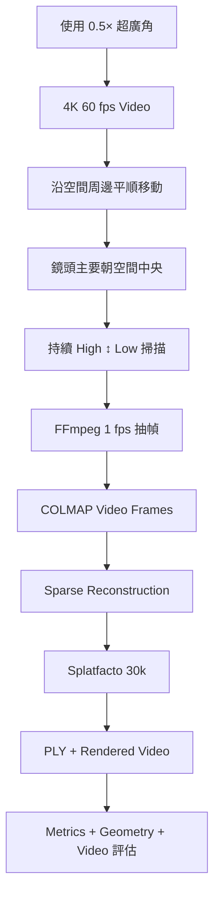

---

## 8.3 本研究最終建議

在類似室內會議室尺度的場景中，可優先採：

1. 0.5× wide-angle。
2. 連續 video capture。
3. 沿牆或空間邊界移動。
4. 鏡頭主要朝空間中心。
5. 持續高低視角掃描。
6. 保持動作平順。
7. 固定時間間隔抽幀。
8. 確保近距離物件被多視角重複觀察。
9. 不以 image count 作為唯一拍攝目標。

---

# 第九章 研究限制

## 9.1 第一階段屬探索性研究

V1-V7 並非全部為嚴格 controlled experiments。

部分版本同時改變：

- Lighting
- Image count
- Camera position
- TV content
- Movement
- Preprocessing

因此早期結果適合用於：

> Problem discovery

而不是單因素 causal conclusion。

---

## 9.2 V8 / V9 無法獨立評估 Device Effect

V8 與 V9 同時不同：

- iPhone model
- Photographer
- Image count
- Real movement

因此無法單獨從這兩個版本證明：

> 裝置型號沒有影響。

---

## 9.3 0.5× 並非完全單變因實驗

V8 / V9 到 V10 / V11 除 lens 外，也有：

- trajectory
- image count
- walking behavior

等差異。

因此目前只能說：

> Wide FOV 與品質提升高度相關。

不能證明：

> 0.5× 是唯一原因。

---

## 9.4 COLMAP Preset 亦有改變

第二階段將：

> Individual Images

改為：

> Video Frames

因此第一、第二階段比較同時包含 COLMAP preset 的差異。

---

## 9.5 Geometry Completeness 缺少統一數值

目前 geometry quality 主要透過：

- Sparse point cloud
- Gaussian PLY
- Rendered video
- Human visual inspection

評估。

尚未建立單一 objective geometry score。

---

## 9.6 主要場景為單一會議室

V11 是否能泛化至：

- 長走廊
- 大型教室
- 狹窄房間
- 高反射場景
- 大型公共空間

仍需進一步驗證。

---

# 第十章 結論與未來工作

## 10.1 結論

本研究歷經 V1-V11，完成了一條由：

> 固定位置拍攝

到：

> Continuous trajectory acquisition

的研究演進。

第一階段建立完整：

```text
Images
→ COLMAP
→ Sparse Model
→ Splatfacto
→ Gaussian PLY
→ Evaluation
→ Render
```

pipeline。

並發現：

- Lighting matters
- Reflection matters
- Image quality matters
- Camera location matters
- Overlap matters
- Blind spot matters
- Image count alone is insufficient

V6 進一步利用 Filter + Highlight Mask 改善前端資料。

然而，第二階段顯示：

> 從資料取得方式本身著手，比在拍攝完成後修正資料能帶來更明顯的提升。

透過：

- 4K 60 fps video
- 1 fps extraction
- Continuous camera movement
- 0.5× wide FOV
- Multi-height observation

V10 / V11 的 reconstruction quality 大幅提升。

最終：

> **V11 被本研究選定為 Overall Best Version。**

---

## 10.2 最重要研究結論

> **高品質室內 3D Gaussian Splatting 的關鍵，不是單純增加影像數量，而是建立良好的 scene coverage、image overlap、viewpoint diversity、wide field of view 與 continuous camera trajectory。**

---

## 10.3 未來工作

後續可建立真正 controlled experiments：

### Lens

```text
0.5× vs 1×
```

固定：

- Same phone
- Same operator
- Same path
- Same lighting

---

### Frame Sampling

比較：

```text
0.5 fps
1 fps
2 fps
```

評估 dataset redundancy 與 reconstruction quality。

---

### Walking Speed

固定：

- Lens
- trajectory
- frame sampling

只改變 walking speed。

---

### Vertical Sweep Frequency

例如：

```text
4 waves / circle
8 waves / circle
16 waves / circle
```

尋找最佳 vertical viewpoint density。

---

### SfM Metrics

未來建議記錄：

- Registered Images
- Registration Ratio
- Sparse Point Count
- Mean Reprojection Error
- Track Length

以解釋：

> 為什麼某個 dataset 在進入 3DGS 前就已經具有較好的幾何條件。

---

### Camera Coverage Analysis

未來可利用 camera poses 建立：

- Coverage heatmap
- Camera position distribution
- View direction distribution
- Baseline distribution

在正式訓練前預測 dataset quality。

---

### Geometry Quality

可進一步建立：

- Missing-region ratio
- Artifact ratio
- Geometry coverage score

降低人工視覺判定的主觀性。

---

# 附錄

## Appendix A：所有版本摘要

| Version | Images | Capture Mode | Lens | Main Strategy | Evaluation |
|---|---:|---|---|---|---|
| V1 | 241 | Photo | 1× | Fixed position | N/A |
| V2 | 389 | Photo | 1× | Denser overlap | N/A |
| V3 | 288 | Photo | 1× | Lights off | Available |
| V4.1 | 303 | Photo | 1× | New position + reverse shots | Available |
| V4.2 | 366 | Photo | 1× | Dense capture, lights off | Available |
| V5 | 263 | Photo | 1× | Reverse blind-spot shots | Available |
| V6 | 276 | Photo | 1× | Filter + Mask | Available |
| V7 | 70 | Photo | 1× | Center + low sample | Available |
| V8 | 390 | 4K60 Video | 1× | 3 circles H/M/L | Available |
| V9 | 328 | 4K60 Video | 1× | 3 circles H/M/L | Available |
| V10 | 445 | 4K60 Video | 0.5× | 3 circles H/M/L | Available |
| V11 | 477 | 4K60 Video | 0.5× | 1 circle + ~16 vertical waves | Available |

---

## Appendix B：Evaluation JSON Files

原始量化資料來源：

```text
3_eval.json
4-1_eval.json
4-2_eval.json
5_eval.json
6_eval.json
7_eval.json
8_evaluation_results.json
9_evaluation_results.json
10_evaluation_results.json
11_evaluation_results.json
```

V1 / V2 無正式 evaluation JSON。

---

## Appendix C：3DGS 主要指令流程

### Process Data

```bash
ns-process-data images \
  --data /content/project/raw_images \
  --skip-colmap \
  --colmap-model-path /content/project/sparse/0 \
  --output-dir /content/nerfstudio_data
```

### Training

```bash
ns-train splatfacto \
  --data /content/nerfstudio_data \
  --vis tensorboard \
  --machine.device-type cuda \
  --viewer.quit-on-train-completion True
```

### Evaluation

```bash
ns-eval \
  --load-config CONFIG_PATH \
  --output-path evaluation_results.json
```

### Gaussian Export

```bash
ns-export gaussian-splat \
  --load-config CONFIG_PATH \
  --output-dir OUTPUT_DIRECTORY
```

---

## Appendix D：研究判定準則

| 項目 | Better Direction | 用途 |
|---|---|---|
| PSNR | ↑ Higher | Pixel fidelity |
| SSIM | ↑ Higher | Structural similarity |
| LPIPS | ↓ Lower | Perceptual similarity |
| Std. Dev. | ↓ Usually more stable | Cross-view consistency |
| Image Count | No fixed direction | Dataset size only |
| Geometry Completeness | ↑ Higher | 3D scene integrity |
| Artifact Amount | ↓ Lower | Visual geometry quality |
| Render Stability | ↑ Higher | Room-tour usability |

---

# 參考文獻

1. Kerbl, B., Kopanas, G., Leimkühler, T., & Drettakis, G. **3D Gaussian Splatting for Real-Time Radiance Field Rendering.** ACM Transactions on Graphics, 2023.

2. Schönberger, J. L., & Frahm, J.-M. **Structure-from-Motion Revisited.** IEEE Conference on Computer Vision and Pattern Recognition, 2016.

3. Knapitsch, A., Park, J., Zhou, Q.-Y., & Koltun, V. **Tanks and Temples: Benchmarking Large-Scale Scene Reconstruction.** ACM Transactions on Graphics, 2017.

4. Wang, Z., Bovik, A. C., Sheikh, H. R., & Simoncelli, E. P. **Image Quality Assessment: From Error Visibility to Structural Similarity.** IEEE Transactions on Image Processing, 2004.

5. Zhang, R., Isola, P., Efros, A. A., Shechtman, E., & Wang, O. **The Unreasonable Effectiveness of Deep Features as a Perceptual Metric.** CVPR, 2018.

6. Tancik, M. et al. **Nerfstudio: A Modular Framework for Neural Radiance Field Development.** SIGGRAPH, 2023.

---

## Project Final Result

```text
Final Overall Best Version: V11

0.5×
4K 60 fps
One perimeter circle
≈16 vertical sweep waves
477 extracted images
1 fps extraction
No Filter
No Mask
COLMAP Video Frames
Splatfacto 30,000 iterations

PSNR  = 29.265 dB
SSIM  = 0.9522
LPIPS = 0.09596
```

> **Final conclusion:**  
> Better camera coverage and trajectory design
